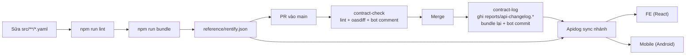

<div align="center">

<h1>Rentify · API Contract</h1>

<p>Hợp đồng OpenAPI 3.0 chuẩn (canonical) của Rentify — nguồn sự thật duy nhất mà backend, web và mobile cùng bám theo.</p>

<p>
  
  
  
  
  
  <a href="https://github.com/pbl6-home-renter/be/actions/workflows/contract-check.yml"></a>
  <a href="https://github.com/pbl6-home-renter/be/actions/workflows/contract-log.yml"></a>
</p>

<p>
  <a href="#giới-thiệu">Giới thiệu</a> •
  <a href="#bắt-đầu-nhanh">Bắt đầu nhanh</a> •
  <a href="#scripts">Scripts</a> •
  <a href="#kiến-trúc">Kiến trúc</a> •
  <a href="#quy-ước-contract">Quy ước contract</a> •
  <a href="#quy-trình-thay-đổi-api">Quy trình thay đổi API</a> •
  <a href="#contract-change-log-tự-động">Changelog</a> •
  <a href="#đóng-góp">Đóng góp</a>
</p>

</div>

## Giới thiệu

Repository này (GitHub: `be`, thư mục local: `api-docs`) lưu **đặc tả API OpenAPI 3.0.3** của Rentify — hệ thống quản lý nhà trọ và tìm bạn ở ghép. Đặc tả được viết bằng YAML module hóa trong `src/`, bundle thành [`reference/rentify.json`](reference/rentify.json) và đồng bộ với dự án **`rentify`** trên Apidog. FE (React) và mobile (Android) build theo contract này; backend service phải khớp với nó.

Hiện contract gồm **93 path / 118 operation**, chia theo 10 tag:

| Tag | Phạm vi | Operation |
|---|---|---:|
| `Auth` | Đăng ký, đăng nhập, refresh, logout, reset mật khẩu, JWKS | 7 |
| `User` | Hồ sơ cá nhân, đổi mật khẩu, quản trị user (lock/unlock) | 9 |
| `Property` | Tòa nhà, phòng, phòng yêu thích | 23 |
| `Contract` | Hợp đồng thuê, thành viên ở cùng, template hợp đồng | 16 |
| `Billing` | Chính sách giá, cài đặt billing, chỉ số công tơ, hóa đơn, thanh toán | 26 |
| `Operation` | Báo cáo sự cố, media, audit log, dashboard | 13 |
| `Chat` | Hội thoại theo phòng/tòa nhà, tin nhắn | 6 |
| `Matching` | Hồ sơ roommate, yêu cầu ghép phòng | 9 |
| `Notification` | Thông báo, tùy chọn thông báo, thiết bị push FCM | 7 |
| `Administrative Units` | Danh mục tỉnh/thành và phường/xã (public) | 2 |

> [!NOTE]
> Mỗi operation có `x-apidog-status`: `released` (đã khớp với service đang chạy) hoặc `designing` (mới ở mức thiết kế). Phần lớn endpoint vẫn ở `designing`; chỉ dựa vào endpoint `released` khi tích hợp thật.

## Tính năng nổi bật

- **Modular YAML** — schema, request/response DTO, wrapper và path tách file theo domain, dễ review trên Git.
- **Một lệnh bundle** — `npm run bundle` giải quyết toàn bộ `$ref` thành một file JSON duy nhất cho Apidog và client.
- **Không cần cài đặt** — mọi script chạy Redocly CLI qua `npx` với version được pin (`2.64.1`).
- **Phát hiện thay đổi contract tự động** — mỗi PR được so sánh base ↔ head bằng `oasdiff`, phân loại `BREAKING` / `NEEDS_REVIEW` / `NON_BREAKING` và bot comment báo cáo kèm hành động cho FE/Mobile.
- **Changelog theo endpoint** — sau khi merge, lịch sử thay đổi được ghi vào `reports/api-changelog.*` và chèn vào description từng endpoint trên Apidog.
- **Apidog tooling** — template environment và script tự động login/refresh token cho request protected.

## Tech stack

| Thành phần | Công nghệ | Ghi chú |
|---|---|---|
| Đặc tả | OpenAPI `3.0.3` (YAML) | Entrypoint `src/openapi.yaml` |
| Lint / bundle / preview | [Redocly CLI](https://redocly.com/docs/cli/) `2.64.1` | Chạy qua `npx --yes`, không có `node_modules` |
| So sánh contract | [oasdiff](https://github.com/oasdiff/oasdiff) `1.34.1` | CI cài bằng pin version + SHA-256 checksum |
| Scripts | Node.js (ESM `.mjs`) | CI dùng Node.js 22 |
| Nền tảng API | Apidog | Đồng bộ trực tiếp từ nhánh Git |
| CI | GitHub Actions | `contract-check.yml`, `contract-log.yml` |

## Bắt đầu nhanh

### Yêu cầu

- Node.js + npm (có `npx`); CI dùng Node.js 22.
- [oasdiff 1.34.1](https://github.com/oasdiff/oasdiff/releases/tag/v1.34.1) trong `PATH` hoặc trỏ biến `OASDIFF_BIN` — **chỉ** cần khi chạy `contract:report` / `contract:demo` ở local.
- Ứng dụng Apidog (để xem/kiểm tra trên dự án `rentify`).

### Cài đặt

```bash
git clone git@github.com:pbl6-home-renter/be.git api-docs
cd api-docs
```

Không cần `npm install`: các script tự tải `@redocly/cli@2.64.1` qua `npx`.

### Chạy

```bash
npm run lint      # kiểm tra cú pháp và quy chuẩn OpenAPI
npm run bundle    # sinh lại reference/rentify.json
npm run preview   # xem tài liệu trên trình duyệt
```

## Scripts

| Lệnh | Mô tả |
|---|---|
| `npm run lint` | `redocly lint src/openapi.yaml` — kiểm tra cú pháp và quy chuẩn trước khi commit |
| `npm run bundle` | Gộp `src/` thành `reference/rentify.json` (`--component-names-strategy title`), sau đó `scripts/inject-changelog.mjs` chèn lịch sử thay đổi từ `reports/api-changelog.json` vào description từng endpoint. YAML trong `src/` không bị sửa |
| `npm run preview` | `redocly preview-docs` — xem trước tài liệu trực tiếp trên trình duyệt |
| `npm run contract:report -- --base-ref <sha> --head-ref <sha>` | Báo cáo thay đổi contract giữa hai commit (cần oasdiff) |
| `npm run contract:demo` | Chạy các fixture mẫu trong `scripts/fixtures/`, ghi `reports/demo/contract-change-report.md` (cần oasdiff) |

## Cấu trúc thư mục

```text
api-docs/
├── src/
│   ├── openapi.yaml            # Entrypoint: info, servers, tags, paths, components
│   ├── common/                 # BaseEntity (id, createdAt, updatedAt, isDeleted)
│   ├── schemas/                # Domain entity: user, property, contract, billing, operation,
│   │                           #   chat, matching, notification, administrative-units, common
│   ├── requests/               # Request body DTO theo nghiệp vụ (auth, buildings, rooms, ...)
│   ├── responses/
│   │   ├── wrappers/           # success-single, success-list, error-default, error-validation
│   │   └── dtos/               # Response DTO theo nghiệp vụ
│   ├── parameters/             # Path / query / header parameter tái sử dụng
│   └── paths/                  # Mỗi file một URL, nhóm theo domain
├── reference/rentify.json      # [AUTO-GENERATED] Bundle OpenAPI để Apidog/client đồng bộ
├── reports/
│   ├── api-changelog.{json,md} # [BOT] Lịch sử thay đổi contract — chỉ GitHub Actions ghi
│   └── demo/                   # Báo cáo mẫu sinh từ fixture
├── scripts/                    # contract-change-report.mjs, inject-changelog.mjs, lib/, fixtures/
├── apidog/                     # Template environment + script pre/post processor
├── note.md                     # Ghi chú phân tích DTO theo domain
└── .github/                    # Workflow contract-check / contract-log, action setup, PR template
```

## Kiến trúc

Contract đi từ YAML nguồn tới client theo pipeline sau:



## Quy ước contract

Tóm tắt các quy ước đang được áp dụng trong `src/`. Khi viết endpoint mới, tái sử dụng các thành phần có sẵn trong `components/responses` và `components/schemas` thay vì định nghĩa lại.

### Response envelope

| Loại | Shape | Wrapper |
|---|---|---|
| Thành công, một đối tượng | `{ statusCode, code, data }` | `SuccessSingleWrapper` |
| Thành công, danh sách | `{ statusCode, code, data: [], pagination }` | `SuccessListWrapper` |
| Lỗi | `{ statusCode, code }` | `ErrorDefaultWrapper` |
| Lỗi validation (422) | `{ statusCode: 422, code: "VALIDATION_FAILED" }` | `ErrorValidationWrapper` |

- `code` là mã nghiệp vụ ổn định, **UPPER_SNAKE_CASE**, để client rẽ nhánh (vd `SESSION_STARTED`, `RESOURCE_NOT_FOUND`).
- Response dùng chung trong `components/responses`: `SuccessSingleResponse`, `SuccessListResponse`, `CreatedResponse`, `AcceptedResponse`, `NoContentResponse`, `BadRequestError` (+ biến thể `Body` / `Query` / `Path` / `BodyPath`), `UnauthorizedError`, `ForbiddenError`, `ForbiddenOnlyError`, `AuthUnavailableError`, `NotFoundError`, `ValidationError`, `TooManyRequestsError`, `InternalServerError`.
- Mã lỗi 400 phân biệt theo nguồn: `INVALID_JSON`, `INVALID_REQUEST_BODY`, `INVALID_QUERY_PARAMETER`, `INVALID_PATH_PARAMETER`, `INVALID_HEADER`.
- Mã lỗi validation giữ nguyên giá trị service trả về, kể cả thông báo tiếng Anh của query validator.

### Phân trang

Offset pagination, khớp `OffsetPaginationQueryRequestDto` / `OffsetPaginationDto` của backend:

| Query | Quy tắc |
|---|---|
| `pageNo` | Số nguyên ≥ 1, mặc định `1` |
| `pageSize` | 1–100, mặc định `20` |
| `sort` | Một field trong whitelist của endpoint, không chứa dấu phẩy |
| `order` | `asc` \| `desc`; bỏ trống thì dùng thứ tự mặc định của endpoint |
| `filter` | deepObject, chỉ field endpoint cho phép — vd `filter[status]=available` |

`pagination` trong response (`PagingMeta`): `type: "offset"`, `pageNo`, `pageSize`, `totalItems`, `totalPages`, `hasNextPage`, `hasPreviousPage`.

### Entity, đặt tên và metadata

- Mọi entity kế thừa `BaseEntity` qua `allOf`: `id` (UUID), `createdAt` / `updatedAt` (date-time UTC), `isDeleted` (soft delete). Ngoại lệ: `AuditLog` (append-only).
- Tên component lấy từ `title` của file (bundle dùng `--component-names-strategy title`): `<Resource><Action>RequestDto` / `<Resource><Action>ResponseDto`, vd `BuildingCreateRequestDto`.
- Tên file kebab-case; file path đặt theo URL với param giữ nguyên tên, vd `/buildings/{buildingId}/approve` → `paths/buildings/buildings-buildingId-approve.yaml`.
- `operationId` camelCase (vd `loginAccount`).
- `x-apidog-folder` gom schema/endpoint vào folder Apidog (`Building`, `Building/Request`, `Building/Response`, `Common/Wrapper`, ...); `x-apidog-status` là `designing` hoặc `released`.

### Bảo mật và server

- Mặc định mọi operation yêu cầu `BearerAuth` (JWT trong `Authorization: Bearer <token>`); endpoint public khai báo `security: []`.
- Server chung: `http://localhost:3000/api/v1` (API Gateway). Các operation Auth/User override server thành `/identity-service/api/v1` khi gọi trực tiếp Identity-Service.

<details>
<summary><b>Ghi chú theo domain đã triển khai</b></summary>

**Auth / User (Identity-Service)**

- Login/register trả token trong JSON, **không** đặt cookie.
- Refresh/logout nhận refresh token trong body JSON; backend thực hiện refresh-token rotation.

**Building (Tenancy-Service)**

- Phản ánh 11 operation đã triển khai: tạo, cập nhật, xóa, approve/reject, danh sách và chi tiết cho landlord/admin, tìm kiếm và chi tiết public (chỉ tòa nhà đã approved, chưa xóa).
- Public Building chỉ hỗ trợ JSON, chưa có export hoặc rate limiter ở service.
- Cấu hình VietQR và tạo rate policy hàng loạt vẫn ở trạng thái thiết kế, có ghi chú chưa triển khai.
- Response giữ các giá trị tạm service đang trả về cho occupancy, media và billing; field dự phòng được giữ kèm mô tả rõ trạng thái hỗ trợ.

**Administrative Units (Tenancy-Service)**

- `GET /administrative-units/provinces` và `GET /administrative-units/provinces/{provinceCode}/wards` là endpoint public, dữ liệu từ snapshot cục bộ; không bao gồm geocoding địa chỉ.

Phân tích chi tiết từng DTO xem [`note.md`](note.md).

</details>

## Quy trình thay đổi API

Checklist cho mỗi thay đổi contract:

- [ ] Tạo nhánh từ nhánh nền, vd `docs/p6-08-administrative-geography` hoặc `feature/<id>-<slug>`.
- [ ] Thêm/sửa schema trong `src/schemas/<domain>/`, DTO trong `src/requests/` hoặc `src/responses/dtos/`; gắn `title` và `x-apidog-folder`.
- [ ] Thêm/sửa path trong `src/paths/<domain>/`; tái sử dụng response/parameter có sẵn; đặt `x-apidog-status` đúng thực tế.
- [ ] Khai báo `$ref` mới (path và component) trong `src/openapi.yaml`.
- [ ] `npm run lint` không lỗi.
- [ ] `npm run bundle` và commit kèm `reference/rentify.json`.
- [ ] Mở PR, **điền mục `## Lý do thay đổi API`** (1–2 câu lý do nghiệp vụ) trong template PR.
- [ ] Đọc comment bot *Kết quả kiểm tra API contract*; nếu `BREAKING` / `NEEDS_REVIEW`, thống nhất với FE/Mobile trước khi merge (cột *Hành động FE / Mobile*).
- [ ] Sau merge: `git pull` (bot vừa commit lên `main`) và sync nhánh trong Apidog.

<details>
<summary><b>Ví dụ schema với <code>x-apidog-folder</code></b></summary>

```yaml
type: object
x-apidog-folder: "User"   # Tên folder hiển thị trên Apidog
title: User
allOf:
  - $ref: '../../common/base-entity.yaml'
  - type: object
    properties:
      phone:
        type: string
```

</details>

<details>
<summary><b>Đồng bộ và kiểm tra trên Apidog</b></summary>

1. Mở Apidog → dự án **`rentify`**.
2. Ở dropdown nhánh Git (góc trên bên trái, cạnh mục APIs): chọn **Fetch from remote** (hoặc **Settings → Git Branches**), rồi chuyển sang nhánh vừa push.
3. Bấm **Sync / Refresh** để nạp commit mới.
4. Tab **Specs** (`{}`): mở `src/openapi.yaml` hoặc `reference/rentify.json` để kiểm tra cú pháp và outline.
5. Tab **APIs**:
   - **Endpoints** — endpoint nằm đúng nhóm, đủ request body, query params và response.
   - **Schemas** — schema nằm đúng folder (`User`, `Building`, `Invoice`, ...), quan hệ `allOf` hiển thị đầy đủ.

</details>

## Contract change log tự động

Dev chỉ cần điền mục `## Lý do thay đổi API` trong mô tả PR; phần còn lại do GitHub Actions làm.

| Thời điểm | Workflow | Kết quả |
|---|---|---|
| Mở/cập nhật PR vào `main` có sửa `src/**` | [`contract-check.yml`](.github/workflows/contract-check.yml) | `npm run lint` → so sánh base ↔ head bằng oasdiff → bot comment báo cáo (cập nhật cùng một comment mỗi lần push). `BREAKING` / `NEEDS_REVIEW`: gắn label `api-breaking` và request reviewer. **Không chặn merge.** |
| Push vào `main` có sửa `src/**` | [`contract-log.yml`](.github/workflows/contract-log.yml) | Ghi entry (kèm link PR + lý do) vào `reports/api-changelog.{json,md}`, `npm run bundle`, rồi `github-actions[bot]` commit lên `main` với `[skip ci]` (retry tối đa 3 lần nếu `main` đã tiến lên). |

**Phân loại:** `BREAKING` = client cũ có thể hỏng · `NEEDS_REVIEW` = cần người xác nhận (mọi thay đổi security luôn ở mức này trở lên) · `NON_BREAKING` = tương thích · `NO_CHANGE`. Sửa description/example/summary/title được coi là không đổi contract.

**FE/Mobile xem ở đâu:** cuối description mỗi endpoint trên Apidog có bảng **Lịch sử thay đổi contract** (5 lần gần nhất); lịch sử đầy đủ ở [`reports/api-changelog.md`](reports/api-changelog.md).

> [!WARNING]
> Không sửa tay `reports/api-changelog.*` — chỉ bot ghi. Commit có `[skip ci]` sẽ không được ghi log; chỉ dùng khi revert thay đổi thử nghiệm (kèm xóa tay entry tương ứng), không dùng cho thay đổi contract thật.

<details>
<summary><b>Lưu ý vận hành CI</b></summary>

- Muốn thử workflow: mở PR, xem comment bot, rồi **đóng PR không merge** — merge là ghi vào changelog thật.
- Reviewer được request tự động lấy từ repository variable `CONTRACT_REVIEWERS` (danh sách username GitHub, cách nhau bởi dấu phẩy). Không đặt thì chỉ gắn label.
- Nếu bật branch protection cho `main`, cần thêm **GitHub Actions** vào bypass list của ruleset, nếu không bot không push được.
- oasdiff trong CI được cài qua composite action `.github/actions/setup-contract-tools` (pin version + checksum).

</details>

## Apidog: environment và tự động refresh token

Template biến môi trường: [`apidog/environment.local.example.json`](apidog/environment.local.example.json) (không chứa credential hay token thật). Tạo environment trong Apidog với các biến tương ứng; đặt `LOGIN_IDENTIFIER`, `LOGIN_PASSWORD`, `accessToken`, `refreshToken` ở **Local Value**. Environment mặc định trỏ tới API Gateway demo:

```text
BASE_URL=http://3.26.114.197/api/v1
```

<details>
<summary><b>Cấu hình login và request protected</b></summary>

**Login** — gọi `POST {{BASE_URL}}/auth/login`:

```json
{
  "identifier": "{{LOGIN_IDENTIFIER}}",
  "password": "{{LOGIN_PASSWORD}}",
  "rememberMe": true
}
```

Gắn [`apidog/scripts/login-post-response.js`](apidog/scripts/login-post-response.js) vào **Post Processors** của request login. Script đọc `data.accessToken` và `data.refreshToken` trong envelope, lưu token cùng thời điểm hết hạn của access token.

**Request protected** — gắn [`apidog/scripts/protected-pre-request.js`](apidog/scripts/protected-pre-request.js) vào **Pre Processors** của folder hoặc request. Script sẽ:

- Gắn `Authorization: Bearer {{accessToken}}` nếu access token còn hạn.
- Gọi `POST {{BASE_URL}}/auth/refresh` với `{ "refreshToken": "..." }` nếu token hết hạn/gần hết hạn.
- Lưu cả access token và refresh token mới sau rotation.
- Xóa session local và yêu cầu login lại nếu refresh thất bại.

> [!IMPORTANT]
> Không gắn script này cho `/auth/login`, `/auth/register` hoặc `/auth/refresh`. Endpoint public không cần Bearer token. Refresh là proactive trước request — Apidog không tự retry request đã nhận `401`. Flow nhiều bước nên dùng Test Scenario thay vì `pm.nextRequest()`.

</details>

## Đóng góp

- Luồng nhánh của workspace: `main` ← `develop` ← `feature/<id>-<slug>` (cũng dùng `fix/`, `hotfix/`, `docs/`, `ci/`); task ID theo `pm/phase-N/issues/`, vd `p6-08`.
- Squash PR, cần ≥ 1 reviewer; không push trực tiếp lên `main` / `develop`.
- Commit message bằng tiếng Anh theo [Conventional Commits](https://www.conventionalcommits.org/), vd `docs(pagination): align PagingMeta and PaginationQueryParams with backend`.

> [!IMPORTANT]
> Các workflow contract chỉ chạy với PR/push vào **`main`** có sửa `src/**`. Mọi thay đổi API trong các repo service phải được phản ánh ở đây và bundle lại — đây là contract mà FE/mobile build theo.

## Hệ sinh thái Rentify

| Repo | Vai trò |
|---|---|
| [`api-gateway`](https://github.com/pbl6-home-renter/api-gateway) | Reverse proxy: định tuyến theo prefix, xác thực JWT/JWKS, rate limit |
| [`Identity-Service`](https://github.com/pbl6-home-renter/Identity-Service) | Xác thực, người dùng, hồ sơ chủ trọ; phát hành JWT RS256 |
| [`Tenancy-Service`](https://github.com/pbl6-home-renter/Tenancy-Service) | Tòa nhà, phòng, đơn vị hành chính |
| [`boilerplate`](https://github.com/pbl6-home-renter/boilerplate) | Template NestJS mà mọi backend service được fork từ |
| **[`be`](https://github.com/pbl6-home-renter/be)** | Hợp đồng OpenAPI 3.0 chuẩn (canonical) |
| [`fe`](https://github.com/pbl6-home-renter/fe) | Web cho chủ trọ (React + Vite) |
| [`mobile`](https://github.com/pbl6-home-renter/mobile) | Ứng dụng Android cho người thuê & chủ trọ |
| [`infra`](https://github.com/pbl6-home-renter/infra) | Docker Compose + Caddy cho hai host EC2 |

## Giấy phép

Dự án học thuật thuộc học phần PBL6 — Trường Đại học Bách khoa, Đại học Đà Nẵng. Chưa phát hành theo giấy phép mã nguồn mở.
